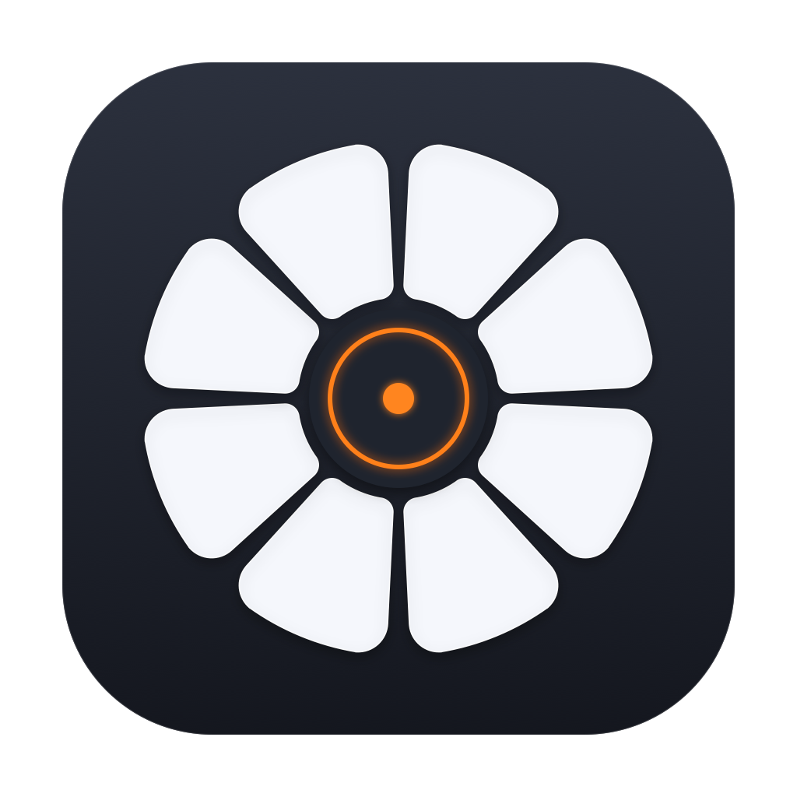

# DropDial



**Drag. Drop. Convert.**

A desktop file conversion and media utility running in the system tray / menu bar. Drag files and use keyboard shortcuts to convert or edit them without opening a bulky main window.

## Features

- **Menu Bar / System Tray Resident**: Never gets in the way of your workspace.
- **Instant Drag & Drop**: Drag files from the desktop or file manager directly onto the tray icon or floating wheel to convert.
- **5 Supported Categories**: Images, Videos, Audio, Documents, and Archives.
- **Advanced Local Tools**:
  - **Images**: Crop, Rotate, Resize, Compress, Watermark, OCR, Metadata removal, Icon sets, Collage, Animation maker.
  - **Videos**: Trim, Crop, Rotate, Speed change, Mute, Frame extraction, Video-to-GIF, Compression.
  - **Audio**: Trim, Loudness normalization, Mono/Stereo channels, Ringtone generator, Visualizer.
  - **Documents**: PDF Merge, Split, Redact, Page Numbers, Password protection, OCR.
  - **Archives**: Fast pack and unpack for ZIP, TAR, GZ, 7z.
- **Non-Intrusive Progress Cards**: Floating status cards in the corner of your screen with Pause, Resume, Cancel, and Open Output Folder buttons.
- **Completely Local & Private**: All conversions and AI/neural OCR happen 100% locally on your machine with zero data uploaded to the cloud.

---

## Quick Install (macOS)

### 1. Terminal (One-Line Install)

Run this single command in Terminal to build/install DropDial to `/Applications`, clear Gatekeeper quarantine, and launch it:

```bash
curl -fsSL https://raw.githubusercontent.com/Nithin1138/lotus/advance-features/install.sh | bash
```

### 2. Website & Direct Download

Download the disk image or archive from the [Releases page](https://github.com/Nithin1138/lotus/releases):
- **`DropDial.dmg`**: Drag `DropDial.app` into `Applications`.
- **`DropDial-macOS.zip`**: Extract and drag into `Applications`.

### 3. Smooth First-Launch & Permissions

When you open DropDial for the first time:
- A welcome window guides you to grant **Accessibility** permission with 1 click.
- **Why Accessibility?** macOS requires this permission for DropDial to detect modifier keys (`⇧ Shift`, `⌘ Cmd`, `⌃ Ctrl`) while you are dragging files from Finder.
- **Live Permission Polling**: The moment you toggle DropDial in *System Settings > Privacy & Security > Accessibility*, DropDial immediately recognizes it and enables drag shortcuts without requiring any restart!
- **Zero-Permission Fallback**: Even without Accessibility permissions, all conversions and tools work via Carbon HotKeys (`F8`, `F9`, `F10`, `⌥ Space`) and by dragging files directly onto the menu bar icon!

---

## macOS Manual Build

```bash
./build-mac.sh
```

This compiles the native Swift application, integrates the Python engine and Apple Vision OCR, and produces:
- `outputs/DropDial-macOS/DropDial.app`
- `outputs/DropDial-macOS/DropDial.dmg`
- `outputs/DropDial-macOS/DropDial-macOS.zip`

Run directly:
```bash
open outputs/DropDial-macOS/DropDial.app
```

See the [macOS User Guide](docs/usage-mac.md) for detailed instructions.

---

## Windows Version

### Build from source

Requires Windows x64 and the .NET 8 SDK.

```powershell
# Prepare runtimes (portable Python, FFmpeg, and 7-Zip)
python work/prepare-runtime.py

# Build the self-contained Windows application
./build.ps1

# Start the application
./outputs/DropDial/DropDial.exe
```

See the [User Guide](docs/usage.md) for full features and details.

---

## Project Structure

| Path | Contents |
| --- | --- |
| `work/DropDial-macOS/` | Native Swift macOS application, menu bar status item, floating wheel, tool windows |
| `work/DropDial/` | C# WPF application, global shortcuts, drag menu, Office bridge, and progress indicators |
| `work/DropDial/backend/` | Python engines for images, media, documents, and archives |
| `build-mac.sh` | macOS build script producing `outputs/DropDial-macOS/DropDial.app` |
| `build.ps1` | Windows build script producing `outputs/DropDial/DropDial.exe` |
| `docs/` | User documentation and usage guides |

---

## License

Project source code is released under the [MIT License](LICENSE).
